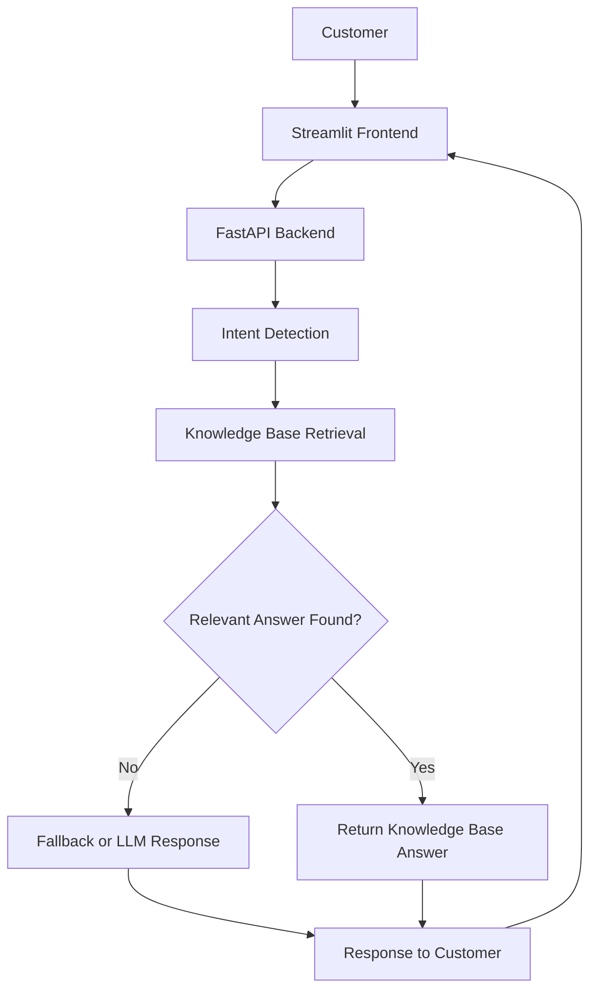

# 🤖 Customer Support Bot

An AI-powered customer support chatbot built with **FastAPI, Streamlit, and Groq**. The application detects customer intent, searches a knowledge base for relevant answers, and uses an LLM to generate responses when appropriate. It also includes fallback handling for unknown or unrelated queries.

## ✨ Features

- **Intent Detection** — Identifies the purpose of customer messages, including refund-related queries.
- **Knowledge Base** — Retrieves relevant answers from a structured JSON knowledge base.
- **Semantic Search** — Supports meaning-based retrieval using sentence-transformer embeddings.
- **LLM Integration** — Uses the Groq API to generate AI-powered responses.
- **Fallback Handling** — Provides a fallback when a reliable knowledge-base match is unavailable.
- **REST API** — Exposes chatbot functionality through a FastAPI backend.
- **Interactive Chat Interface** — Provides a Streamlit frontend for conversations.
- **Automated Testing** — Includes pytest tests for API behaviour, valid requests, error handling, and fallback scenarios.

## 🏗️ Architecture

The application follows a modular architecture that separates the frontend, API, conversation logic, retrieval, and language model integration.



### How it works

1. A customer enters a question through the Streamlit chat interface.
2. The frontend sends the message to the FastAPI backend.
3. The application identifies the customer's intent.
4. The retrieval component searches the knowledge base for relevant information.
5. If a suitable answer is found, the bot uses the retrieved information; otherwise, it applies the configured fallback or LLM response logic.
6. The response is returned to the frontend and displayed in the conversation.

## 🛠️ Tech Stack

| Technology | Purpose |
|---|---|
| Python | Core application logic |
| FastAPI | Backend API development |
| Streamlit | Interactive chatbot interface |
| Groq API | Large language model integration |
| Sentence Transformers | Semantic search and text embeddings |
| Pydantic | Data validation |
| Requests | HTTP communication between frontend and backend |
| Pytest | Automated testing |
| JSON | Knowledge base storage |
| python-dotenv | Environment variable management |

## 📁 Project Structure

```text
Customer Support Bot/
│
├── app/
│   ├── main.py              # FastAPI application
│   ├── conversation.py      # Conversation processing
│   ├── intent_detection.py  # Customer intent detection
│   ├── knowledge_base.py    # Knowledge base access
│   ├── semantic_search.py   # Semantic retrieval
│   └── llm.py               # Groq LLM integration
│
├── data/
│   └── knowledge_base.json  # Customer support information
│
├── tests/                   # Automated test suite
│
├── frontend.py              # Streamlit chat interface
├── test_llm.py              # LLM integration tests
├── requirements.txt         # Project dependencies
├── .gitignore               # Excluded files
└── .env                     # Local environment variables
```

**Security note:** The `.env` file should remain local and must never be committed to GitHub.

## ⚙️ Installation and Setup

### Prerequisites

- Python 3.11 or later
- [Git](https://git-scm.com/)
- [uv](https://docs.astral.sh/uv/)
- A Groq API key

### 1. Clone the repository

Replace `YOUR_USERNAME` with your GitHub username and `YOUR_REPOSITORY` with your repository name.

```bash
git clone https://github.com/YOUR_USERNAME/YOUR_REPOSITORY.git
cd "Customer Support Bot"
```

If you have already cloned the repository, simply navigate to its project directory.

### 2. Create and activate a virtual environment

Create the environment with `uv`:

```bash
uv venv
```

Activate it on Windows PowerShell:

```powershell
.venv\Scripts\Activate.ps1
```

Alternatively, use Git Bash:

```bash
source .venv/Scripts/activate
```

### 3. Install dependencies

```bash
uv pip install -r requirements.txt
```

### 4. Configure environment variables

Create a `.env` file in the project root:

```env
GROQ_API_KEY=your_groq_api_key_here
```

Replace the placeholder with your own API key. Never share or commit your real API key.

### 5. Start the FastAPI backend

From the project root, run:

```bash
uvicorn app.main:app --reload
```

Open the interactive API documentation:

**http://127.0.0.1:8000/docs**

### 6. Start the Streamlit frontend

Open a second terminal, activate the same virtual environment, and run:

```bash
streamlit run frontend.py
```

The Streamlit application will provide a local URL, typically:

**http://localhost:8501**

Keep the backend running while using the frontend.

## 🧪 Testing

The project includes automated tests implemented with pytest and FastAPI's testing tools.

Run the test suite from the project root:

```bash
pytest -v
```

To measure code coverage:

```bash
pytest --cov=app --cov-report=term-missing
```

The test suite has previously completed successfully with **8 passing tests**. Results may change as the codebase evolves.

Test scenarios include:

- Valid customer messages
- Empty message validation
- Refund-related questions
- Unknown intents and fallback behaviour
- API health checks
- Error handling and request validation

## 💬 Example Use Cases

| Customer message | Expected behaviour |
|---|---|
| "When will I receive my refund?" | Detects refund intent and retrieves relevant support guidance |
| "How can I contact customer support?" | Searches for relevant contact information if available in the knowledge base |
| "I need help with an order." | Identifies the intent or requests clarification if necessary |
| An unrelated question | Uses the configured fallback behaviour |

Actual answers depend on the knowledge base, intent detection, and configured response logic.

## 🔐 Security and Reliability

- Store
